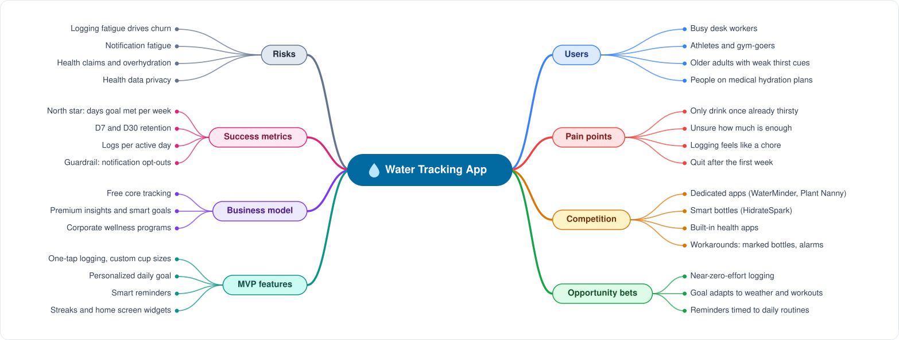

# Water Tracking App: Discovery Mindmap

> Discovery groundwork for a hydration-tracking product: who it serves, what pain it removes, what it needs to ship, and how we would know it's working. Feeds `strategic-map.md` and `problem-hook.md`.

Mindmap as text

- **Users**
  - Busy desk workers
  - Athletes and gym-goers
  - Older adults with weak thirst cues
  - People on medical hydration plans
- **Pain points**
  - Only drink once already thirsty
  - Unsure how much is enough
  - Logging feels like a chore
  - Quit after the first week
- **Competition**
  - Dedicated apps (WaterMinder, Plant Nanny)
  - Smart bottles (HidrateSpark)
  - Built-in health apps
  - Workarounds: marked bottles, alarms
- **Opportunity bets**
  - Near-zero-effort logging
  - Goal adapts to weather and workouts
  - Reminders timed to daily routines
- **MVP features**
  - One-tap logging, custom cup sizes
  - Personalized daily goal
  - Smart reminders
  - Streaks and home screen widgets
- **Business model**
  - Free core tracking
  - Premium insights and smart goals
  - Corporate wellness programs
- **Success metrics**
  - North star: days goal met per week
  - D7 and D30 retention
  - Logs per active day
  - Guardrail: notification opt-outs
- **Risks**
  - Logging fatigue drives churn
  - Notification fatigue
  - Health claims and overhydration
  - Health data privacy

## Where the strategic weight is

- **The core problem is effort, not knowledge.** Most people know they should drink more. They stop logging after a week or two, so the bet is *near-zero-effort logging*, not more education.
- **Reminders cut both ways.** They drive logs but also opt-outs and uninstalls. Measure logs gained from reminders against notification opt-outs.
- **Built-in health apps are free.** A standalone app has to win on personalization (workouts, weather, routine) or it's a commodity.
